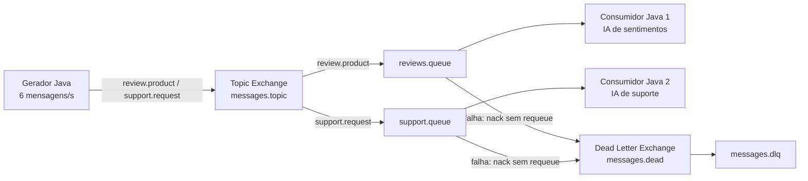

# Sistema distribuído de classificação de mensagens com RabbitMQ

Projeto da Atividade 5 de Sistemas Distribuídos. Quatro contêineres geram, encaminham e classificam mensagens de avaliações de produtos e solicitações de suporte. A inferência acontece localmente em dois modelos independentes, treinados com [Smile](https://haifengl.github.io/) dentro dos respectivos consumidores.

## Arquitetura



O `compose.yaml` cria exatamente quatro contêineres: `rabbitmq`, `generator`, `review-consumer` e `support-consumer`. Os três serviços Java usam o mesmo `Dockerfile` e recebem papéis diferentes por `APP_ROLE`. A DLQ é uma fila dentro do contêiner RabbitMQ, não um quinto serviço.

| Elemento | Nome ou valor |
|---|---|
| Topic Exchange | `messages.topic` |
| Routing keys | `review.product`, `support.request` |
| Filas principais | `reviews.queue`, `support.queue` |
| Dead Letter Exchange | `messages.dead` |
| Dead Letter Queue | `messages.dlq` |
| Rede | `trabalho5` do Compose |
| Interface RabbitMQ | <http://localhost:15672> |

## Requisitos para executar

- Docker Engine/Desktop com Docker Compose.
- Acesso à internet no primeiro build para baixar as imagens e dependências Maven.
- Porta local `15672` livre. A porta AMQP permanece apenas na rede do Compose.

Não é preciso instalar Java nem Maven na máquina host: o build usa Java 21 e Maven dentro da imagem de construção. O primeiro build pode demorar alguns minutos.

## Início rápido

No PowerShell, dentro desta pasta:

```powershell
docker compose up --build -d
docker compose ps
docker compose logs -f generator review-consumer support-consumer
```

A interface está em <http://localhost:15672>. Usuário: `demo`; senha: `demo123`. Esses valores são apenas para execução local e podem ser alterados pelas variáveis `RABBITMQ_USER` e `RABBITMQ_PASS` antes de iniciar o Compose. Para interromper: `docker compose down`. Para zerar filas e dados de demonstração: `docker compose down -v`.

## Fluxo das mensagens

O gerador publica por padrão **6 mensagens por segundo**, alternando três avaliações e três pedidos de suporte. O mínimo exigido é 5 mensagens/s; ajuste `MESSAGES_PER_SECOND` para outro inteiro maior ou igual a 5. Os exemplos têm rótulos esperados apenas nos logs do gerador para conferência; o campo não é enviado à fila nem lido pelos classificadores.

Cada mensagem é JSON em UTF-8 e contém `id` UUID, `generatedAt` em UTC/ISO-8601, `type` e `content`. Exemplo:

```json
{
  "id": "93f47d58-946c-41f3-8c21-28b6910295bf",
  "generatedAt": "2026-10-13T12:00:00Z",
  "type": "review.product",
  "content": "Produto excelente, chegou rápido e funciona perfeitamente."
}
```

O gerador declara o Topic Exchange e as filas, publica mensagens persistentes e aguarda confirmação do RabbitMQ. Os consumidores usam `autoAck=false` e `basicQos(1)`: só enviam `basicAck` depois de validar e classificar. Assim, a contagem **Ready** das filas cresce enquanto cada consumidor trabalha mais lentamente que a chegada de mensagens. Por padrão, cada consumidor leva 1500 ms por mensagem, aproximadamente 0,67 mensagem/s, enquanto sua fila recebe cerca de 3 mensagens/s. Ajuste `CONSUMER_DELAY_MS` se necessário.

Erros de JSON, campos obrigatórios inválidos, tipos incorretos e textos impossíveis de classificar geram `basicNack(..., requeue=false)`. As filas principais estão configuradas com `x-dead-letter-exchange=messages.dead` e `x-dead-letter-routing-key=failed`, que levam a mensagem para `messages.dlq`. Uma interrupção do processo durante o consumo usa `requeue=true`, para permitir nova tentativa após reiniciar.

## As duas IAs

Cada consumidor carrega um CSV próprio em `src/main/resources/training`, monta seu vocabulário, transforma texto em contagens de palavras e treina um **Naive Bayes multinomial** com a biblioteca Smile. A normalização converte para minúsculas, remove acentos e pontuação e ignora algumas palavras muito comuns. Não há chamada a serviço externo de IA.

| Consumidor | Base | Classes de saída |
|---|---|---|
| Avaliações | `training/reviews.csv`, 36 exemplos | `positiva`, `negativa`, `neutra` |
| Suporte | `training/support.csv`, 36 exemplos | `problema de acesso`, `problema de desempenho`, `problema de conexão` |

Os CSVs são pequenos e didáticos, criados para esta atividade. Demonstram treinamento e inferência reais, mas não representam um modelo de produção nem garantem boa acurácia em textos arbitrários. As frases geradas para a execução ficam separadas da base de treino.

## Verificação da execução

Use `docker compose ps` para conferir os quatro contêineres e `docker compose logs generator review-consumer support-consumer` para acompanhar a geração e as classificações. Na interface RabbitMQ, o exchange `messages.topic` mostra os vínculos das duas filas; a aba **Queues and Streams** mostra o aumento de `Ready`.

Para testar a DLQ, execute `./scripts/inject-error.ps1`. O script publica JSON inválido com a chave `review.product`; o consumidor o rejeita com NACK sem requeue, e o RabbitMQ o encaminha para `messages.dlq`. Se houver muitas avaliações aguardando, pare o gerador com `docker compose stop generator`, esvazie somente `reviews.queue` pela interface RabbitMQ e então execute o script. Reinicie o gerador com `docker compose start generator`.

As capturas e os registros reais da execução estão em `evidencias/`.

## Vídeo de demonstração

[Assistir à demonstração (5 minutos)](https://youtu.be/5YZC3EW2NZs).

## Referências técnicas

- [RabbitMQ: Topic Exchange](https://www.rabbitmq.com/tutorials/tutorial-five-java)
- [RabbitMQ: confirmações de consumo e prefetch](https://www.rabbitmq.com/docs/confirms)
- [RabbitMQ: Dead Letter Exchanges](https://www.rabbitmq.com/docs/dlx)
- [Smile: classificador DiscreteNaiveBayes](https://haifengl.github.io/api/java/smile/classification/DiscreteNaiveBayes.html)
